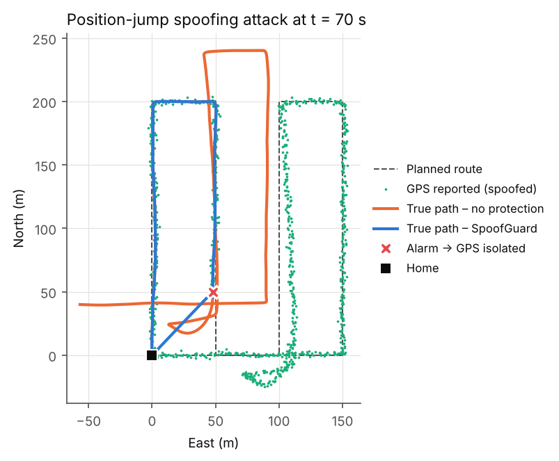

# SpoofGuard

**Multi-layer GPS spoofing and jamming detection with fail-safe navigation for UAVs**

M Ramaa Gayatri · Electronics & Communication Engineering, New Horizon College of Engineering, Bengaluru
BSERC Def-Space Autumn Internship 2026 · Drone Technology domain

---

**▶ [Demo video (1.5 min)](SpoofGuard_Demo.mp4)** · **📄 [Project report (PDF)](SpoofGuard_Report.pdf)**



A drone's autopilot trusts GPS. A spoofer can broadcast fake GPS signals and quietly
steer the drone somewhere else while the autopilot believes it is on course.
SpoofGuard watches for that lie from three directions at once:

| Family | Check | What it catches |
|---|---|---|
| Signal level | C/N0 signature across satellites | Single-transmitter spoofers (all satellites suddenly equally strong); jamming (signal collapse) |
| Measurement consistency | Innovation χ² gate, CUSUM on NIS | Sudden position jumps; anything the Kalman filter finds statistically impossible |
| Physics consistency | IMU–GPS velocity consistency (10 s window), baro–GPS altitude | Slow "carry-off" attacks that hide inside GPS noise |

When an alarm is raised, GPS is isolated, the drone holds for 5 s, then returns home on
IMU + barometer dead reckoning.

## Run it

```bash
pip install numpy scipy matplotlib reportlab
python run_experiments.py --quick    # ~1 min, sanity check
python run_experiments.py            # full Monte Carlo, ~5-8 min
python make_report.py                # builds SpoofGuard_Report.pdf from results/
python make_video.py                 # builds SpoofGuard_Demo.mp4 (needs ffmpeg)
```

Single flight from Python:

```python
from spoofguard.sim import run_mission, scenario
r = run_mission(scenario("drift"), protected=True, seed=1)
print(r["delay"], r["reason"], r["final_home_err"])
```

Scenarios: `nominal`, `jamming`, `jump`, `drift`, `stealth`.

## Files

| File | Purpose |
|---|---|
| `spoofguard/sim.py` | Drone, sensors, attacks, Kalman filter, integrity monitor, fail-safe |
| `run_experiments.py` | Monte Carlo experiments + all figures → `results/` |
| `make_report.py` | Builds the PDF report from `results/summary.json` |
| `make_video.py` | Builds the demo video from the simulation |
| `HOW_IT_WORKS.md` | Plain-language walkthrough of every part of the code |

## Scope and assumptions

Simulation only. Attitude is assumed known from the autopilot's AHRS, so the filter is a
linear 9-state GNSS/INS filter. C/N0 values are modelled, not recorded from a receiver.
See the report's *Limitations* section before quoting numbers.
